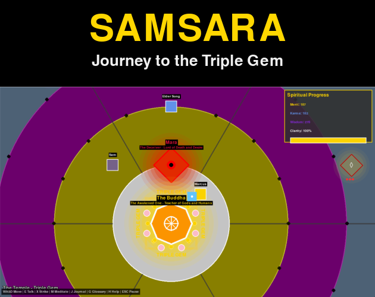
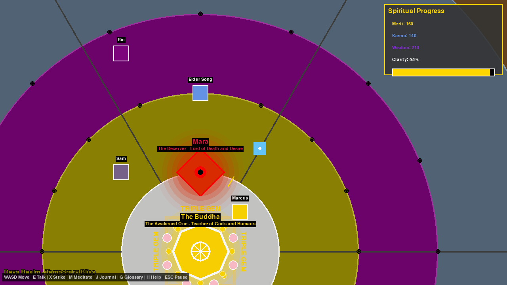
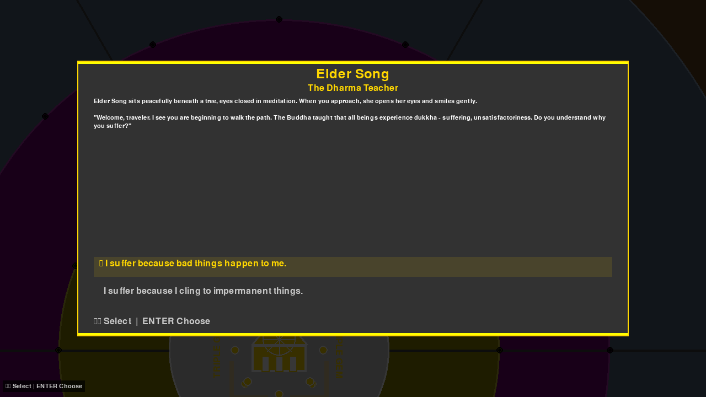
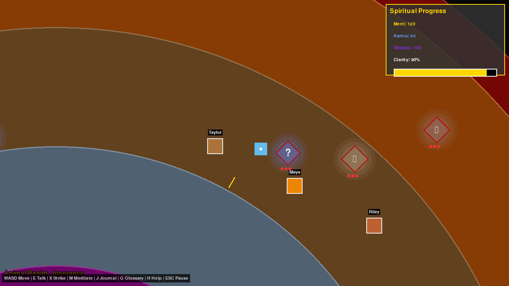
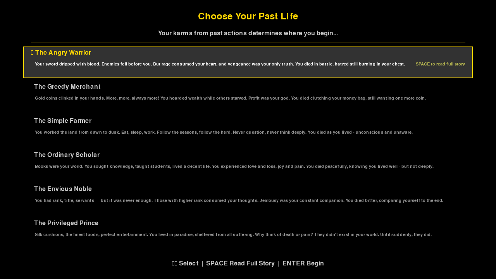
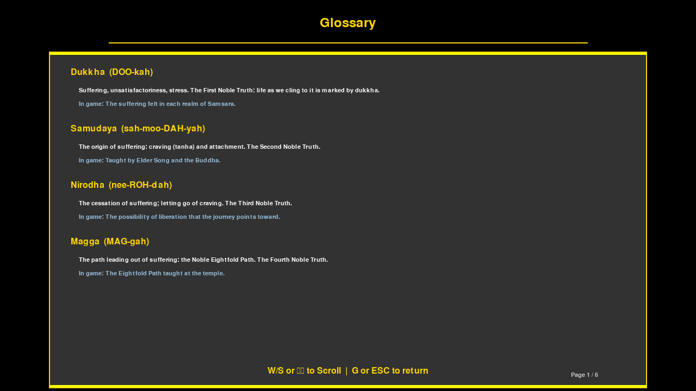
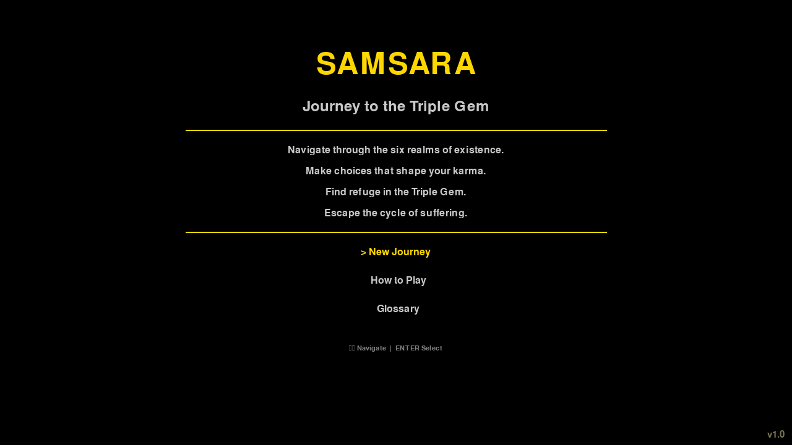

# Samsara: Journey to the Triple Gem

A top-down 2D Buddhist RPG where every moral choice shapes your soul. Navigate six realms of existence, help suffering beings, face Mara, and find refuge in the Triple Gem.

🎮 **Play in browser:** https://smoald.itch.io/samsara-triple-gem-game
🕹️ **All my games:** https://smoald.itch.io/

## What It Does

- Explore six Buddhist realms — Hell, Hungry Ghost, Animal, Human, Asura, Deva — as concentric circles on a world map
- Talk to suffering beings and make moral choices that grow your Merit, Karma, and Wisdom
- A fog of ignorance hides the world until your wisdom grows and your vision clears
- Face Mara (the demon of delusion), then seek the Buddha to win
- Meditate, keep a journal, read a Buddhist glossary, and unlock achievements along the way
- Save your progress across three save slots with autosave

## Screenshots

The cover and screenshots from the itch.io store page.

<table>
  <tr><td align="center"> The Buddha at the centre of the realms</td><td align="center"> Talking with Elder Song, the Dharma teacher</td></tr>
  <tr><td align="center"> Exploring the realms</td><td align="center"> Choosing your past life</td></tr>
  <tr><td align="center"> The Buddhist glossary</td><td align="center"> Main menu</td></tr>
</table>

## Built With

- **Python / Pygame** — the game engine
- **Pygbag** — converts the game to WebAssembly (the technology that lets it run in a browser)
- **PyInstaller** — packages the game into a standalone Windows exe (no Python install needed)
- **Itch.io** — where the game is hosted and played

## How to Run It

**In the browser (easiest):**
Go to https://smoald.itch.io/samsara-triple-gem-game and click **Play in browser**. Works in Chrome and Edge.

**On Windows — ready to play (v2.0):**
1. Download `Samsara_Windows_v2.0.zip` from the [GitHub Releases](https://github.com/joshuablakemorekay/samsara-triple-gem-game/releases) or itch.io
2. Unzip and double-click `Samsara.exe` — no Python or installation required

**On Windows — source code version:**
For developers or anyone who wants to run or explore the Python files directly.
1. Download `Samsara_Windows.zip` from [GitHub Releases](https://github.com/joshuablakemorekay/samsara-triple-gem-game/releases) or itch.io
2. Install Python 3.12 and run `pip install pygame`
3. Run `main.py` — full instructions in the included `HOW_TO_PLAY_WINDOWS.txt`

> The v2.0 Windows build is packaged with PyInstaller, which bundles Python and all dependencies so anyone can play without any setup.

## My Journey

**2026-05-30 — Touchscreen controls for the browser version**
Added on-screen controls to the browser build so it plays on iPads and touch laptops — a D-pad, Talk / Strike / Pause buttons, menu navigation, and a Story button to read each past life. The desktop version is untouched; this is browser-only. I merged the feature into the existing build by changing only three files and leaving the other 560+ byte-for-byte identical, then fixed a double-tap bug and hid the controls until the screen is touched.
Key lesson: a browser fires two events for one tap (a finger event and a "pretend" mouse event), so without de-duplication every tap counts twice. The browser build is also its own separate async version of the game — you can't drop desktop files straight into it.

**2026-05-29 — Building a standalone Windows exe (v2.0)**
Packaged the full-featured source code version into a double-click exe and offered both a ready-to-play build and a source code zip on itch.io. Fixed two PyInstaller path bugs before it would work: data files needed a `resource_path()` helper to find them inside the bundle, and save files needed redirecting away from the temp folder that gets deleted on close.
Key lesson: PyInstaller uses your system's default Python — if that's not the version your game runs on, the exe builds silently but crashes at launch. Always specify the Python version explicitly.

**2026-05-29 — Getting Samsara into the browser: two rounds of fixes**
Ported the game to Itch.io using Pygbag (WebAssembly). Round 1 was getting it to load at all — fixed audio blocking the loader, a browser security header blocking the CDN, a font rendering bug, and an NPC dialogue layout issue. Round 2 was making it smooth — found and removed 70+ transparent surfaces being allocated every frame across six files, bumped all font sizes, and fixed a broken pause screen.
Key lessons: browser environments are strict in ways desktop never is — diagnose from the console, fix one blocker at a time. In WebAssembly, never allocate inside the draw loop.

## What's Next

- Add background music that plays after the first user click (browser audio rules require this)
- Fine-tune the new touch controls for smaller phone screens
- Mac and Linux builds via GitHub Actions
